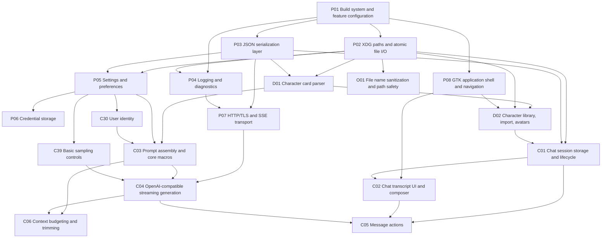

# SillyTavern Port — Full Feature and Dependency Matrix

Source analyzed: SillyTavern `1.19.0`.

This is the full-parity feature set. It is intentionally broader than v0.1.
Every feature is classified as **critical** or **non-critical**, and every
dependency edge is listed in both directions.

## Criticality rule

> Removing the feature breaks the loop: launch -> import/select character -> configure model -> send/receive -> persist/reload, for a single-user local install.

## Summary

| Measure | Count |
|---|---:|
| Features in full-parity set | 105 |
| Critical features | 19 |
| v0.1 target features | 19 |
| Ported features | 1 |

Status values in the registry: `planned` means the feature is visible in
`make menuconfig` but disabled; `ported` means it is implemented, builds,
and has been committed.

## v0.1 critical dependency graph

## Feature tables

`Depends on` lists prerequisites. `Required by` lists dependants. Both use
feature IDs; names are in the same table.

### Platform and build

| ID | Feature | Critical | Plan | Status | Depends on | Required by |
|---|---|:---:|---|---|---|---|
| P01 | Build system and feature configuration | **yes** | v0.1 | ported | — | P02, P03, P04, P08, P11 |
| P02 | XDG paths and atomic file I/O | **yes** | v0.1 | planned | P01 | B12, C01, D01, D02, D11, O01, O02, P04, P05, P09, P10 |
| P03 | JSON serialization layer | **yes** | v0.1 | planned | P01 | C01, D01, P05, P07 |
| P04 | Logging and diagnostics | **yes** | v0.1 | planned | P01, P02 | O05, P07 |
| P05 | Settings and preferences | **yes** | v0.1 | planned | P02, P03 | C03, C29, C30, C36, C39, P06 |
| P06 | Credential storage | **yes** | v0.1 | planned | P05 | O05 |
| P07 | HTTP/TLS and SSE transport | **yes** | v0.1 | planned | P03, P04 | B01, B02, B03, B04, B05, B06, B12, C04, C27, C37, O03, U08, U09, U10, U11, U17 |
| P08 | GTK application shell and navigation | **yes** | v0.1 | planned | P01 | C02, D02, P12, P13, P14, U01, U02, U03, U04, U05 |
| P09 | Single-instance and data locking | no | later | planned | P02 | — |
| P10 | Crash recovery and autosave journal | no | later | planned | P02 | — |
| P11 | Packaging and install targets | no | later | planned | P01 | — |
| P12 | Internationalization | no | later | planned | P08 | — |
| P13 | Accessibility | no | later | planned | P08 | — |
| P14 | DPI and theme integration | no | later | planned | P08 | — |

### Character management

| ID | Feature | Critical | Plan | Status | Depends on | Required by |
|---|---|:---:|---|---|---|---|
| D01 | Character card parser | **yes** | v0.1 | planned | P02, P03 | C03, D02, D04, D07, D08, D10, U14 |
| D02 | Character library, import, avatars | **yes** | v0.1 | planned | D01, P02, P08 | C01, D03, D05, D06, U07, U16 |
| D03 | Character editor | no | later | planned | D02 | — |
| D04 | Character export | no | later | planned | D01 | — |
| D05 | Alternate greetings | no | later | planned | D02, C01 | — |
| D06 | Tags, favorites, search, sort | no | later | planned | D02 | — |
| D07 | Character book | no | later | planned | D01, C31 | — |
| D08 | CharX and BYAF import | no | later | planned | D01 | — |
| D09 | Chat import and export | no | later | planned | C01 | — |
| D10 | Bulk data migration | no | later | planned | D01, C01 | — |
| D11 | Asset and gallery storage | no | later | planned | P02 | C21, C28, U10, U12 |

### Chat, prompting, and generation

| ID | Feature | Critical | Plan | Status | Depends on | Required by |
|---|---|:---:|---|---|---|---|
| C01 | Chat session storage and lifecycle | **yes** | v0.1 | planned | P02, P03, D02 | C02, C05, C08, C09, C10, C11, D05, D09, D10, U13, U14, U16 |
| C02 | Chat transcript UI and composer | **yes** | v0.1 | planned | P08, C01 | C05, C17, C21, C22, C24, U06, U08, U09, U11 |
| C03 | Prompt assembly and core macros | **yes** | v0.1 | planned | D01, P05, C30 | B01, B02, B03, B04, B05, B06, C04, C06, C09, C13, C14, C15, C16, C22, C23, C25, C26, C27, C29, C31, C34, C40 |
| C04 | OpenAI-compatible streaming generation | **yes** | v0.1 | planned | P07, C03, C39 | B07, C05, C06, C12, C13, C18, C19, C20, C26, C36, C37, C38, U07 |
| C05 | Message actions | **yes** | v0.1 | planned | C01, C02, C04 | C07 |
| C06 | Context budgeting and trimming | **yes** | v0.1 | planned | C03, C04 | C33 |
| C07 | Swipes and alternate responses | no | later | planned | C05 | — |
| C08 | Branching and bookmarks | no | later | planned | C01 | — |
| C09 | Group chats | no | later | planned | C01, C03 | — |
| C10 | Chat search | no | later | planned | C01 | — |
| C11 | Chat backups | no | later | planned | C01 | U15 |
| C12 | Auto-continue | no | later | planned | C04 | — |
| C13 | Impersonation | no | later | planned | C03, C04 | — |
| C14 | Author's note | no | later | planned | C03 | — |
| C15 | Instruct mode | no | later | planned | C03 | — |
| C16 | Context templates | no | later | planned | C03 | — |
| C17 | Markdown and rich formatting | no | later | planned | C02 | — |
| C18 | Reasoning display | no | later | planned | C04 | — |
| C19 | Tool calling | no | later | planned | C04 | — |
| C20 | Logprobs display | no | later | planned | C04 | — |
| C21 | Attachments and inline images | no | later | planned | C02, D11 | — |
| C22 | Slash commands and STscript | no | later | planned | C02, C03 | — |
| C23 | Variables | no | later | planned | C03 | — |
| C24 | Quick replies | no | later | planned | C02 | — |
| C25 | Regex transformations | no | later | planned | C03 | — |
| C26 | Summarize and memory | no | later | planned | C03, C04 | — |
| C27 | Vector storage and RAG | no | later | planned | C03, P07 | B08, C28 |
| C28 | Data bank | no | later | planned | D11, C27 | — |
| C29 | Persona manager | no | later | planned | P05, C03 | — |
| C30 | User identity | **yes** | v0.1 | planned | P05 | C03 |
| C31 | World Info engine | no | later | planned | C03 | C32, D07 |
| C32 | World Info editor and import | no | later | planned | C31 | — |
| C33 | Exact tokenizer and token counter | no | later | planned | C06 | U19 |
| C34 | Prompt manager and presets | no | later | planned | C03 | C35 |
| C35 | Preset import and export | no | later | planned | C34 | — |
| C36 | Connection profiles | no | later | planned | P05, C04 | — |
| C37 | Custom headers and proxy | no | later | planned | P07, C04 | — |
| C38 | Advanced sampler settings | no | later | planned | C04 | — |
| C39 | Basic sampling controls | **yes** | v0.1 | planned | P05 | C04 |
| C40 | Prompt post-processing | no | later | planned | C03 | — |

### User interface and media

| ID | Feature | Critical | Plan | Status | Depends on | Required by |
|---|---|:---:|---|---|---|---|
| U01 | Themes and user CSS | no | later | planned | P08 | — |
| U02 | Backgrounds | no | later | planned | P08 | — |
| U03 | Movable UI | no | later | planned | P08 | — |
| U04 | Keyboard shortcuts | no | later | planned | P08 | — |
| U05 | Welcome screen and responsive layout | no | later | planned | P08 | — |
| U06 | Bulk message edit | no | later | planned | C02 | — |
| U07 | Character expressions and sprites | no | later | planned | D02, C04 | — |
| U08 | TTS and STT | no | later | planned | C02, P07 | B09 |
| U09 | Image generation | no | later | planned | C02, P07 | B10 |
| U10 | Image captioning | no | later | planned | D11, P07 | — |
| U11 | Chat translation | no | later | planned | C02, P07 | B11 |
| U12 | Gallery browser | no | later | planned | D11 | — |
| U13 | Stats dashboard | no | later | planned | C01 | — |
| U14 | Data Maid | no | later | planned | D01, C01 | — |
| U15 | Backups manager | no | later | planned | C11 | — |
| U16 | Global search | no | later | planned | D02, C01 | — |
| U17 | Extension manager | no | later | planned | P07 | U18 |
| U18 | Plugin API | no | later | planned | U17 | O06 |
| U19 | Token counter UI | no | later | planned | C33 | — |

### Model backends and interoperability

| ID | Feature | Critical | Plan | Status | Depends on | Required by |
|---|---|:---:|---|---|---|---|
| B01 | Anthropic native API | no | later | planned | P07, C03 | — |
| B02 | Google Gemini API | no | later | planned | P07, C03 | — |
| B03 | Text-completion backends | no | later | planned | P07, C03 | — |
| B04 | NovelAI API | no | later | planned | P07, C03 | — |
| B05 | AI Horde | no | later | planned | P07, C03 | — |
| B06 | Azure OpenAI | no | later | planned | P07, C03 | — |
| B07 | OpenRouter features | no | later | planned | C04 | — |
| B08 | Embeddings backends | no | later | planned | C27 | — |
| B09 | Speech backends | no | later | planned | U08 | — |
| B10 | Image generation backends | no | later | planned | U09 | — |
| B11 | Translation backends | no | later | planned | U11 | — |
| B12 | Remote server and API mode | no | later | planned | P02, P07 | B13, B14, B15, O04 |
| B13 | Multi-user accounts and auth | no | later | planned | B12 | — |
| B14 | Host security | no | later | planned | B12 | — |
| B15 | Web client | no | later | planned | B12 | — |

### Operations and security

| ID | Feature | Critical | Plan | Status | Depends on | Required by |
|---|---|:---:|---|---|---|---|
| O01 | File name sanitization and path safety | **yes** | v0.1 | planned | P02 | — |
| O02 | Backup and restore | no | later | planned | P02 | — |
| O03 | Update checker | no | later | planned | P07 | — |
| O04 | Healthcheck and integrity | no | later | planned | B12 | — |
| O05 | Secret redaction | no | later | planned | P04, P06 | — |
| O06 | Plugin security sandbox | no | later | planned | U18 | — |

## Notes

- Criticality is about the single-user local core loop, not about how
  commonly a feature is used. World Info is important to many users but is
  not required to import a card, chat, and persist the result.
- A feature is only marked `ported` after its implementation, tests, build
  verification, log update, and commit are complete.
- `make menuconfig` must render every non-ported feature dimmed and
  unselectable. Critical v0.1 features are locked on.
- Feature IDs are stable. New features get new IDs; retired IDs are not
  reused.
